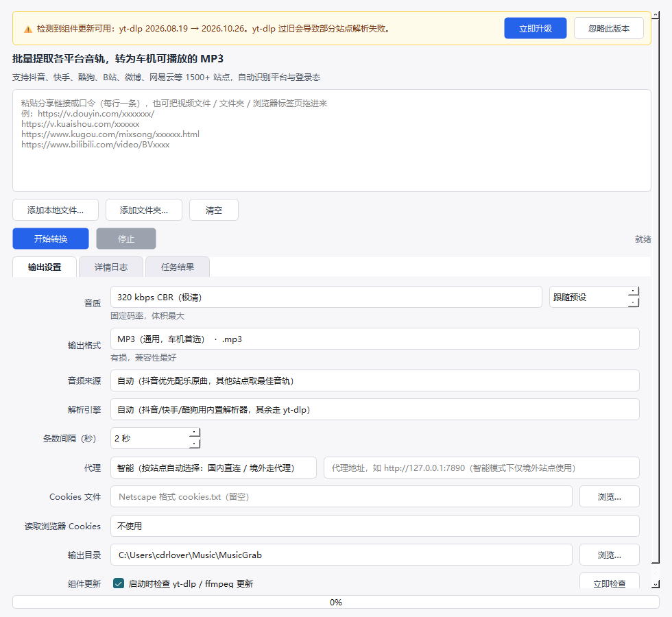

# 乐取 MusicGrab — 多平台音轨批量提取转 MP3（抖音 / 快手 / 酷狗 / B站 / 微博 / 网易云 等）

批量粘贴视频或音乐分享链接，自动识别平台并提取其中的音轨，转换为**车机系统可直接播放**的 MP3。

> 当前版本 **v1.8.0** · Windows x64 · 免安装单文件（约 102 MB）· [发布说明](docs/releases/v1.8.0.md)

- **车机友好**：MP3、ID3v2.3 标签（歌名/歌手/专辑/来源注释）、44.1kHz 双声道、V0 可变码率或 96–320 kbps 固定码率
- **格式齐全**：MP3 / M4A / Opus / FLAC / WAV，外加 **BEST（源格式不转码）**；可把封面图嵌入音频文件
- **批量处理**：一次粘贴多条，自动识别平台并排队转换；**单条右键重试**、失败项一键重试
- **双引擎**：国内主流平台优先用内置解析器（更省资源、更适配），其余走 yt-dlp 通用引擎（覆盖范围极广）
- **不挑网络**：智能路由——国内平台直连、境外站点自动走代理，代理不通会明确提示而非误报"风控"
- **能自我更新**：内置的 yt-dlp / ffmpeg 虽被冻结在 exe 里，但启动时会自检版本并提示一键升级（见 [4.4](#44-组件自检与在线升级)）
- **本地化体验**：支持 Cookies、代理、失败重试、防风控间隔、CSV 转换报告

## 1. 支持平台

| 平台 | 引擎 | 说明 |
|---|---|---|
| 抖音 | 内置解析器（推荐） | 支持分享口令整段粘贴、`v.douyin.com` 短链、`www.douyin.com/video/...`、`?modal_id=...` 等，可选配乐原曲/视频音轨 |
| 快手 | 内置解析器（推荐） | 支持 `v.kuaishou.com` 短链，自动取最高码率音轨。部分作品需登录或 App 环境 |
| 酷狗 | 内置解析器（推荐） | 支持 `www.kugou.com/mixsong/...`、`www.kugou.com/song/...`、带 `hash=` 的链接等，自动提取可用音频并写入 ID3 标签。**VIP/付费歌曲需登录**（配合 `--cookies-from-browser` 或 `cookies.txt`）；接口可能随酷狗改版而失效 |
| B 站、微博、网易云音乐、优酷、爱奇艺、腾讯视频、芒果 TV、AcFun 等 | yt-dlp 通用引擎 | 大多数可直接提取音轨并打上 ID3 标签 |
| 西瓜视频、小红书、QQ 音乐等 | yt-dlp 通用引擎 | 部分需要登录，建议配合 `--cookies-from-browser` 或 `cookies.txt` 使用 |
| YouTube、TikTok、X(Twitter)、Instagram、Niconico、SoundCloud 等境外站点 | yt-dlp 通用引擎 | **需自备代理**，直连可能超时 |

> 完整清单、支持形态及实测结果见 [docs/SUPPORTED_SITES.md](docs/SUPPORTED_SITES.md)。yt-dlp 当前内置 1751 个 extractor，理论上可覆盖 1500+ 站点；用「组件升级」更新到最新版后 extractor 增至 1754（见 [4.4](#44-组件自检与在线升级)）。

## 2. 功能一览

- **批量转换**：支持多行粘贴、分享口令混合、批量排队
- **多行工具条**：粘贴 2 条以上时自动出现下拉工具条，可统计平台分布、一键提取纯链接、去重、按平台排序、载入示例
- **本地文件输入**：除网络链接外，还可直接导入本地视频/音频（mp4 / mkv / mov / avi / flv / wmv / webm / ts / rmvb / mpg 等 30+ 常见容器），直接提取音轨
- **解析引擎切换**：`auto`（默认，智能选择）/ `douyin`（强制内置解析器）/ `generic`（强制 yt-dlp）
- **音频来源（抖音专用）**：`auto` / `video`（视频音轨）/ `music`（纯配乐）
- **音质调节**：`V0`（LAME 最佳可变码率，推荐）/ 320 / 256 / 192 / 128 / 96 kbps 固定码率，也可自定义 32～320 kbps；无损格式与 BEST 自动忽略码率
- **输出格式可选**：MP3 / M4A / Opus / FLAC / WAV / **BEST（源格式不转码）**。MP3 写 ID3v2.3（车机兼容最好），其余写各容器原生标签
- **封面嵌入**：自动抓取平台封面（抖音/快手/酷狗/yt-dlp 站点）并写入音频文件；本地视频则抽第一帧作封面。WAV/Opus 不支持封面，自动跳过
- **任务结果面板**：逐条列出成功/失败/跳过，支持右键打开文件、打开文件夹、复制来源、**单条重试**与**一键重试全部失败项**
- **登录站点支持**：`--cookies`（Netscape 格式）或 `--cookies-from-browser`（edge/chrome/firefox/chromium/brave/opera）
- **智能路由**：默认「智能」模式——**国内平台直连**（CDN 全球可达），**境外站点自动走代理**（未填代理时先探测直连可达性，不通则提示配置代理）。另有「全部直连」「全部走代理」两种强制模式。启动前会**预检代理连通性**，代理不通会立即给出明确提示（不再误报为“风控”）
- **组件自检与在线升级**：内置的 yt-dlp / ffmpeg 是打包时冻结的副本，**不会自动更新**。程序启动时联网比对官方最新版本，发现新版本会在窗口顶部弹出提示条，可一键下载官方安装包就地升级（见 [4.4](#44-组件自检与在线升级)）
- **内置 ffmpeg**：使用 `imageio-ffmpeg`，开箱即用无需手动配置
- **稳健处理**：防风控间隔、失败自动重试、文件重名自动编号、转换 CSV 报告
- **双界面**：图形界面（PySide6）+ 命令行（`douyin-mp3`）

## 3. 环境准备

### 方式 A：直接使用成品（最省事）
如果已拿到 `dist\MusicGrab.exe`，双击即可运行，无需安装 Python 环境。

### 方式 B：从源码运行
需要 Python 3.10+。

```powershell
# 克隆仓库（示例）
git clone <your-repo-url>
cd douyin-mp3

# 安装依赖
pip install -r requirements.txt

# （可选）安装 GUI 依赖
pip install -e ".[gui]"

# （可选）开发依赖（测试、打包）
pip install -e ".[dev]"
```

## 4. 使用方法

### 4.1 图形界面（推荐）

```powershell
# 成品（推荐）：双击 dist\MusicGrab.exe，无控制台窗口
# 源码方式（不想看到控制台窗口时用 pythonw）
pythonw -m douyin_mp3
# 或双击项目根目录的 乐取.pyw

# 安装包方式（pip install -e . 后）
pythonw -m douyin_mp3
# 或
乐取 MusicGrab

# 命令行模式（需要控制台输出）
python -m douyin_mp3 convert "https://v.douyin.com/xxx/" -o "D:\Music"
```

> **关于黑色控制台窗口一闪而过**：打包版（`--windowed`）本身不附带控制台，
> 但它调用的 ffmpeg / ffprobe 是控制台程序，Windows 会为子进程新建控制台窗口。
> 程序已在启动时对 `subprocess` 做全局处理：父进程无控制台时自动为所有子进程
> 加上 `CREATE_NO_WINDOW`，因此运行全程不再有终端窗口闪现（命令行模式不受影响）。

界面要点：
- **链接输入**：将分享口令或链接粘贴到文本框，每行一条即可
- **多行工具条**：粘贴 **2 条以上**时自动出现，显示识别到的条数与平台分布（`抖音×2 快手×1 …`），右侧「批量操作…」可一键**提取纯链接 / 去重 / 按平台排序 / 载入示例 / 清空**
- **添加本地文件…**：直接导入本地视频或音频（可多选），会追加到输入框，与网络链接混合处理
- **开始/停止**：位于选项页上方，支持随时停止当前批量任务
- **更新横幅**：启动自检发现 yt-dlp / ffmpeg 有新版本时，窗口顶部出现黄色横幅（见 [4.4](#44-组件自检与在线升级)）
- **输出设置**（选项页）：音质、输出格式、音频来源、解析引擎、条数间隔、代理、Cookies、浏览器 Cookies、输出目录、**组件更新**
- **详情日志**（选项页）：查看解析、下载、转码的完整过程，便于排查问题
- **任务结果**（选项页）：表格展示每条任务的状态/标题/歌手/时长/大小/输出文件；**右键**可打开文件、打开所在文件夹、复制来源地址、重试此任务，顶部按钮可**一键重试全部失败项**
- **进度显示**：仅显示百分比进度，转换完成后会弹窗提示成功/失败数量

### 4.2 命令行

```powershell
# 抖音 / 快手 / 酷狗（内置解析器，默认 auto 即可）
douyin-mp3 convert "https://v.douyin.com/xxxxxxx/" "https://v.kuaishou.com/xxxxxx" "https://www.kugou.com/mixsong/xxxxxx.html" -q 192 -o "D:\Music\车机音乐"

# B站、微博、网易云等（自动走 yt-dlp）
douyin-mp3 convert "https://www.bilibili.com/video/BV1xx411c7mD" "https://music.163.com/song?id=xxxx" -q 320

# 需登录站点：从已登录的浏览器读取 cookies（使用前请完全退出该浏览器）
douyin-mp3 convert "https://m.ixigua.com/video/xxxx" --cookies-from-browser edge

# 使用本地 cookies.txt（Netscape 格式）
douyin-mp3 convert "https://y.qq.com/n/ryqq/songDetail/xxx" --cookies ".\cookies.txt"

# 多平台混合 + 代理（境外站点）
douyin-mp3 convert "分享口令 https://v.douyin.com/aaa/" "https://youtu.be/xxxxxxxx" `
  --quality 320 --source auto --engine auto --proxy http://127.0.0.1:7890 --skip-existing

# 本地视频文件直接提取音轨（可与网络链接混合）
douyin-mp3 convert "D:\视频\MV.mp4" "D:\视频\翻唱.mkv" -q 320 -f flac

# 最佳 VBR（MP3 专用）+ 嵌入封面
douyin-mp3 convert "https://v.douyin.com/aaa/" -q v0 -f mp3

# BEST：直接复制源音轨，不转码、零损失（输出扩展名随源而定）
douyin-mp3 convert "https://www.bilibili.com/video/BV1xx411c7mD" -f best

# 检查 yt-dlp / ffmpeg 组件是否有新版本（打包后内置组件不会自动更新）
douyin-mp3 check-update
douyin-mp3 check-update --json          # 脚本化处理
douyin-mp3 check-update --upgrade       # 直接下载安装（重启后生效）
```

#### 命令行参数说明

**子命令**

| 子命令 | 说明 |
|---|---|
| `convert` | 批量转换（默认主命令） |
| `gui` | 启动图形界面（默认） |
| `check-update` | 检查 yt-dlp / ffmpeg 组件版本，可选 `--json` / `--upgrade` |

**`convert` 参数**

| 参数 | 默认值 | 说明 |
|---|---|---|
| `urls`（位置参数） | 必填 | 一条或多条分享链接/口令/本地文件路径，支持混合粘贴 |
| `-q, --quality` | `320` | `v0`（最佳 VBR）/ `96`/`128`/`192`/`256`/`320` CBR，或 `32-320` 任意整数；无损格式与 BEST 自动忽略 |
| `-f, --format` | `mp3` | 输出格式：`mp3`/`m4a`/`opus`/`flac`/`wav`/`best`（源格式不转码） |
| `-s, --source` | `auto` | `auto`/`video`/`music`（仅抖音内置解析器生效） |
| `--engine` | `auto` | `auto`（智能选择）/`douyin`（强制内置：抖音、快手）/`generic`（强制 yt-dlp） |
| `-o, --output` | `~/Music/MusicGrab` | 输出目录（会自动创建） |
| `--proxy` | 空 | 代理地址，如 `http://127.0.0.1:7890`、`socks5://127.0.0.1:7891` |
| `--route` | `auto` | 路由模式：`auto`=智能（国内直连 / 境外走代理）/ `direct`=全部直连 / `proxy`=全部走代理 |
| `--cookies` | 空 | `cookies.txt` 路径（需为 Netscape 格式） |
| `--cookies-from-browser` | 空 | 从浏览器提取 cookies：`edge`、`chrome`、`firefox`、`chromium`、`brave`、`opera`、`vivaldi` 等 |
| `--ffmpeg` | 空（自动） | 指定自定义 `ffmpeg.exe` 路径，默认优先使用 `imageio-ffmpeg` 内置 |
| `--skip-existing` | 否 | 跳过已存在的同名文件（可避免重复转换） |
| `--delay` | `2` | 每条链接之间的间隔秒数（有助于降低风控概率） |

**`check-update` 参数**

| 参数 | 默认值 | 说明 |
|---|---|---|
| `--json` | 否 | 以 JSON 输出，便于脚本处理 |
| `--upgrade` | 否 | 发现新版本时直接下载安装（需要重启程序后生效） |

### 4.3 输出格式与本地文件

**输出格式**（GUI 中在「输出设置 → 输出格式」选择，或 CLI 用 `-f/--format`）

| 格式 | 编码 | 音质设置 | 特点 / 适用场景 |
|---|---|---|---|
| **MP3** | libmp3lame | V0 或 CBR | 有损，ID3v2.3 标签；**车机首选**，兼容性最好 |
| M4A | aac | CBR | 有损，体积小；Apple 生态 / iOS 设备 |
| Opus | libopus | CBR | 有损，高压缩比；语音 / 低码率（固定 48kHz） |
| FLAC | flac | 忽略 | 无损压缩；无损收藏，体积小于 WAV |
| WAV | pcm_s16le | 忽略 | 无损、未压缩；需要原始波形，体积大 |
| **BEST** | copy | 忽略 | **不转码，直接复制源音轨**；零损失、速度最快 |

**音质选项**（GUI「输出设置 → 音质」，或 CLI `-q/--quality`）

| 选项 | 行为 |
|---|---|
| `V0`（推荐） | LAME 最佳可变码率，同体积下质量最好；**仅 MP3 生效**，其他有损格式自动按 320k 处理 |
| `320` / `256` / `192` / `128` / `96` | 固定码率（CBR）；**默认 320** |
| 自定义 32–320 | 在 GUI 右侧输入框填写，或 CLI 直接传数字 |
| 无损 / BEST | 码率设置自动忽略（FLAC/WAV 天然无损，BEST 不重编码） |

> 除 MP3 使用 ID3v2.3 外，其余格式写入各容器原生标签（FLAC 写 Vorbis Comment、M4A 写 MP4 Atom、WAV 写 LIST-INFO）。Opus 固定使用 48kHz（格式限制），其余统一 44.1kHz 双声道。

**封面嵌入**：抖音 / 快手 / 酷狗 / yt-dlp 站点会尝试下载平台封面并写入音频；本地视频则抽第 1 秒的一帧作为封面。MP3 / M4A / FLAC 支持封面，WAV / Opus 容器没有标准封面位置，会自动跳过（不会导致转换失败）。封面下载失败也不影响音频输出。

**BEST 模式**会先探测源音频编码，再决定输出容器，避免"容器装不下该编码"导致失败：

| 源音频编码 | 输出扩展名 |
|---|---|
| mp3 | `.mp3` |
| aac / alac | `.m4a` |
| opus | `.opus` |
| vorbis | `.ogg` |
| flac | `.flac` |
| pcm_* | `.wav` |
| 其他未知 | 沿用源文件扩展名；无扩展名时用 `.mka` |

**本地文件**：程序会自动识别输入行中的本地路径，支持 30+ 常见视频容器（mp4 / mkv / mov / avi / flv / f4v / wmv / webm / ts / m2ts / 3gp / rmvb / rm / mpg / mpeg / vob / asf / ogv / divx …）及常见音频格式（mp3 / wav / flac / m4a / ogg / opus / wma / ape / aiff…）。本地文件**不需要解析与下载**，直接用 ffmpeg 提取音轨，标题取自文件名。

### 4.4 组件自检与在线升级

程序用 PyInstaller 打成单文件 exe，**yt-dlp 与 ffmpeg 都被「冻结」在 exe 内部**，
上游更新不会自动生效。而 yt-dlp 几乎每周发版，原因就是目标站点一改版它就得跟着修——
这意味着用户手里的旧程序会**静默失效**：昨天还能下的链接今天下不到了，
而用户既不知道原因，也不可能自己升级一个绿色单文件 exe。

> 换句话说：打包分发省掉了"装 Python"的步骤，却给依赖更新埋下了债。
> v1.7.0 起加入了一套「运行时自愈」机制把这笔债还上。

| 阶段 | 行为 |
|---|---|
| **启动自检** | 后台线程联网比对官方最新稳定版（**不阻塞界面**，检查失败静默降级） |
| **提示** | 窗口顶部弹出黄色横幅：`⚠ 检测到组件更新可用：yt-dlp 2026.08.19 → 2026.10.26`，可「立即升级 / 忽略此版本」 |
| **升级** | 从 PyPI 官方仓库下载官方 wheel（国内自动切镜像），校验 SHA256 后解压安装到本机覆盖层 |
| **生效** | yt-dlp 走自定义 import finder 优先加载外置副本；ffmpeg 走路径优先级 + `IMAGEIO_FFMPEG_EXE` 环境变量。**重启一次即生效** |



**具体行为**

- 下载源：优先 `pypi.org`（拿最新稳定版号），超时或失败自动切清华 / 阿里 / 腾讯 / 华为镜像
- 覆盖层目录：`%LOCALAPPDATA%\MusicGrab\`（`yt_dlp/`、`ffmpeg/`、`state.json`）
- 「忽略此版本」会记在 `state.json` 里，同一版本不再提示
- 不想联网：GUI「输出设置 → 组件更新」可关闭启动时检查，或点「立即检查」手动触发
- **升级失败不会破坏现有程序**：内置组件始终保留，任何一步失败（下载中断 / 校验不符 / 解压异常）
  都回退到内置版本继续工作
- 下载包带 SHA256 校验，解压做了 zip-slip 路径穿越防护，安装走「临时目录 → 原子替换 → 失败回滚」

**命令行同样可用**：

```powershell
douyin-mp3 check-update              # 打印当前版本与最新版本
douyin-mp3 check-update --json       # 结构化输出，便于脚本处理
douyin-mp3 check-update --upgrade    # 直接下载安装（重启后生效）
```

```text
组件版本自检（C:\Users\<用户>\AppData\Local\MusicGrab）
  yt-dlp（通用解析引擎）: 2026.08.19 → 2026.10.26  [有更新]
  ffmpeg（转码内核）: 0.6.0 → 0.6.0  [已是最新]
      内置 ffmpeg 7.1
```

> 内置的抖音/快手/酷狗解析器是自研实现，**不依赖 yt-dlp**，因此 yt-dlp 过旧只影响
> 「其他 1500+ 站点」这条兜底线，核心功能不受影响。

### 4.5 路由模式（直连 / 代理）

程序**逐条**决定每条链接走直连还是走代理，规则如下（GUI「输出设置 → 代理」，CLI `--route`）：

| 模式 | 行为 | 适用场景 |
|---|---|---|
| **智能 `auto`（默认）** | 国内平台 → **直连**；境外站点 → **优先用「代理」框中的代理**，未填则先探测直连可达性：可达就直连（境外用户场景），不通但系统有代理则跟随系统代理，两者都没有则**直接提示"该站点需要代理"**，不再傻等超时 | 绝大多数用户 |
| 全部直连 `direct` | 所有请求直连，完全忽略 Windows 系统代理与 `HTTP_PROXY` 环境变量 | 只用国内平台 / 排查代理问题 |
| 全部代理 `proxy` | 所有请求（含国内站点）都走「代理」框中的代理 | 需要统一出口 IP / 隐私需求 |

**判定依据**是目标域名而非用户所在地：

- **国内平台**（抖音 `douyin.com`、快手 `kuaishou.com`、酷狗 `kugou.com`、B站 `bilibili.com`、微博 `weibo.com`、网易云 `163.com`、西瓜 `ixigua.com`、小红书 `xiaohongshu.com`…）→ CDN 全球可达，**直连对国内和境外用户都成立**
- **境外站点**（YouTube、TikTok、X、Instagram、Facebook、Reddit、SoundCloud、Niconico、Vimeo、Twitch、Spotify…）→ 国内网络通常不通，走代理
- **未知域名** → 直连尝试，失败再按超时提示引导

> **境外用户怎么办？** 中国平台的 CDN 在全球都有节点，抖音/快手/B站/酷狗/网易云在德国、美国均可直连访问，因此"国内平台 → 直连"这条规则对境外用户同样成立。境外用户唯一需要代理的场景是"访问自己国家被限制的站点"——此时在「代理」中填上自己的代理地址即可（智能模式下会自动对境外站点使用它）。

**运行日志**会逐条打印实际路由，便于核对：

```
路由模式: 智能（按站点自动选择：国内直连 / 境外走代理）
规则: 国内平台直连 · 境外站点优先用指定代理，无代理时尝试系统代理/直连
[1/2] 路由: 国内平台 www.douyin.com，直连
[2/2] 路由: 境外站点 www.youtube.com，使用代理 http://127.0.0.1:7890
```

## 5. 故障排查（常见问题）

| 问题 | 原因 | 解决方案 |
|---|---|---|
| **解析失败 / “页面无数据”** | 抖音/快手风控、作品已删除、或需要登录环境 | 稍后重试、换网络、使用 `--engine auto` 让程序自动切换；部分快手作品仅 App 可见暂时无法解析 |
| **抖音链接怎么复制** | 抖音未提供固定的分享链接格式 | 以下形式**均可直接粘贴**，无需特意点「转发 → 复制链接」：① 浏览器地址栏的 `https://www.douyin.com/video/{id}`；② 网页版浏览时的 `https://www.douyin.com/discover?modal_id={id}`；③ 分享面板「复制链接」得到的 `https://v.douyin.com/xxxxx/`；④「复制口令」的整段文字 |
| **“需 cookies” / 登录相关报错** | 西瓜、小红书、QQ 音乐等站点需登录态 | 完全退出浏览器后用 `--cookies-from-browser <浏览器名>`，或导出 Netscape 格式 `cookies.txt` 并用 `--cookies` 指定 |
| **酷狗提示“VIP/付费歌曲”** | 该曲目为酷狗 VIP/付费内容，未登录不返回播放地址 | 登录酷狗后导出 cookies，用 `--cookies-from-browser edge` 或 `--cookies cookies.txt` 重试 |
| **境外站点超时（YouTube/TikTok/X/Instagram）** | 本机直连境外网络不可用 | 配置代理（如 Clash/V2rayN）后设置 `--proxy http://127.0.0.1:7890`（以实际端口为准） |
| **“代理无法连接”** | 代理软件没启动 / 端口填错 | 启动代理软件并确认端口（Clash 默认 7890、v2rayN 常见 10809/10089）；或在「代理」中改用「全部直连」模式。程序会在开始前预检代理并立即提示，不再逐条重试 |
| **“境外站点 xxx 在当前网络下不可达”** | 该站点在当前网络下无法直连 | 在「输出设置 → 代理」填写代理地址（如 `http://127.0.0.1:7890`），智能模式会自动对境外站点使用它 |
| **境外站点连接失败 / 超时** | 代理未配置或配置错误 | 同上；或把路由模式改为「全部代理」强制所有请求走代理 |
| **读取浏览器 cookies 失败** | 浏览器未完全退出、加密存储、权限受限 | 关闭所有浏览器进程（检查任务管理器），以当前用户权限运行程序，再重试 |
| **某个站点突然解析不了** | 内置 yt-dlp 版本过旧（目标站点改版后 yt-dlp 需要跟进更新） | 用窗口顶部的「立即升级」把 yt-dlp 更新到最新；或从「输出设置 → 组件更新」点「立即检查」 |
| **没看到更新提示** | ① 已勾选「忽略此版本」；② 关闭了「启动时检查组件更新」；③ 网络访问不到 PyPI | 点「输出设置 → 组件更新 → 立即检查」手动触发；国内网络下程序会自动切镜像，若仍失败说明确实连不上 PyPI |
| **组件升级失败** | 下载中断 / SHA256 校验不符 / 解压异常 | 提示框会说明原因；**内置组件未被替换，程序照常可用**。换个网络重试，或手动从 PyPI 下载 wheel 后解压到 `%LOCALAPPDATA%\MusicGrab\yt_dlp\` |
| **升级后版本没变** | yt-dlp 升级需要重启程序才生效（当前会话已加载的模块无法热替换） | 退出并重新启动程序；ffmpeg 无此限制，升级后立即生效 |
| **转码报错 / 找不到 ffmpeg** | 环境异常或自定义路径错误 | 默认已用 `imageio-ffmpeg`，如仍报错可用 `--ffmpeg "C:\path\to\ffmpeg.exe"` 手动指定；也可尝试升级 ffmpeg 组件 |
| **音质偏低 / 只能提取试听片段** | 平台限制或仅提供低码率音轨 | 部分平台确实只提供预览音频，换其他链接或站点可能会有更好选择 |
| **文件名乱码/特殊字符** | 原标题含特殊符号 | 程序已做文件名清洗，会自动替换非法字符并用编号避免重名 |
| **本地文件没被识别** | 扩展名不在支持列表 | 确认是常见视频/音频格式（mp4/mkv/mov/avi/flv/wmv/webm/ts/rmvb/mpg… 或 mp3/wav/flac/m4a/ogg/opus/wma）；路径需为完整路径 |
| **Opus 转换失败** | Opus 编码器要求 48kHz | 程序已自动对 Opus 改用 48kHz；若仍失败请用 FLAC 或 MP3 |
| **BEST 输出的不是 .mp3** | BEST = 源格式不转码，扩展名由源音频编码决定 | 这是预期行为（如 B 站 AAC 音轨输出 `.m4a`）；需要统一 MP3 请选 `mp3` 格式 |
| **封面没有嵌入** | WAV / Opus 容器不支持封面，或平台未提供封面 / 封面下载失败 | 改用 MP3 / M4A / FLAC；封面缺失不会影响音频本身 |
| **个别任务失败想重跑** | 网络抖动、临时风控或 cookies 失效 | 切到「任务结果」页，右键该行选「重试此任务」；或点顶部「重试全部失败项」，编号与文件名保持不变 |
| **车机不认某个格式** | 车机解码能力有限 | 老车机建议用 MP3（ID3v2.3），部分车机仅支持 MP3/WAV |

> 提示：工具会在转换完成后生成 `conversion_report_*.csv`，记录每条链接的状态、文件名、时长、大小等，便于复盘和排查。

## 6. 生成应用（打包成 EXE）

适合在无 Python 环境的 Windows 机器上分发。

```powershell
# 安装打包依赖
pip install pyinstaller

# 执行打包脚本
powershell -ExecutionPolicy Bypass -File packaging\build_exe.ps1
```

产物：
- `dist\MusicGrab.exe` — 单文件、无控制台、内置图标和版本信息（约 102 MB）
- `dist\MusicGrab_*.msix`（如需）— Microsoft Store/侧载用的 MSIX 安装包

> **为什么用 `--collect-all` 而不是 `--collect-binaries`？**
> `yt_dlp` 与 `imageio_ffmpeg` 都用 `--collect-all`：包内除二进制外还要落下 `.py` 源码，
> 否则运行时读不到版本号（源码在 PYZ 里，磁盘上没有），组件自检会误报"有更新"。
> 代价只是几十 KB。

打包细节见 `packaging/` 目录（`build_exe.ps1`、`version_info.txt`、`msix/AppxManifest.xml`）。

## 7. 测试、文档与发布

```powershell
# 运行单元测试（103 个）
pytest tests -q
```

端到端验证脚本（需联网，属开发工具）：

```powershell
python packaging\check_upgrade_e2e.py       # 真实下载安装 + 验证覆盖层生效
python packaging\check_overlay_usable.py    # 验证外置 yt-dlp 可正常解析
python packaging\check_quit_race.py          # 验证关闭程序不会异常终止
python packaging\check_bundled.py            # 检查 exe 内嵌的组件与版本
```

相关文档：
- [docs/SUPPORTED_SITES.md](docs/SUPPORTED_SITES.md) — 平台支持清单与实测明细
- [docs/releases/v1.8.0.md](docs/releases/v1.8.0.md) — 当前版本发布说明（格式/音质体系、封面、任务重试）
- [docs/releases/v1.7.0.md](docs/releases/v1.7.0.md) — 上一版本（组件自检与在线升级）
- [docs/blog/CSDN-技术博文.md](docs/blog/CSDN-技术博文.md) — 完整开发复盘长文（架构 / 踩坑 / 合规）
- [docs/STORE_CHECKLIST.md](docs/STORE_CHECKLIST.md) — Microsoft Store 发布检查清单
- [docs/PRIVACY_POLICY.md](docs/PRIVACY_POLICY.md) — 隐私政策模板

## 8. 免责声明与许可

- **仅供个人学习研究**：本工具仅供个人学习、研究和非商业用途使用。请勿将其用于商业运营、批量分发或任何侵犯他人版权的场景。
- **责任自负**：用户需自行遵守所访问平台的服务条款及所在地法律法规。因使用本工具产生的任何法律责任由使用者自行承担。
- **公开链接为准**：本工具仅处理用户**主动粘贴的公开分享链接**，不内置破解、绕过 DRM 或获取付费内容的功能。
- **隐私**：程序完全本地运行，不会上传链接、Cookies 或下载文件到第三方服务器。Cookies 仅用于访问用户已登录的站点请求。唯一的对外请求是目标站点、用户自行配置的代理，以及**组件版本自检时的 PyPI / 国内镜像**（只查询版本号，不发送任何本地信息，可在「输出设置 → 组件更新」关闭）。
- **第三方许可**：程序内含 GPLv3 的 FFmpeg 与 Unlicense 的 yt-dlp，详见 [LICENSE](LICENSE) 与发布说明中的许可章节。

**License:** [MIT](LICENSE)
