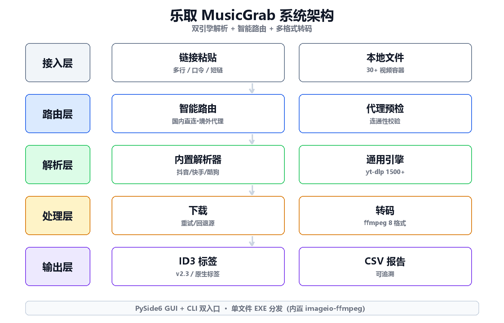
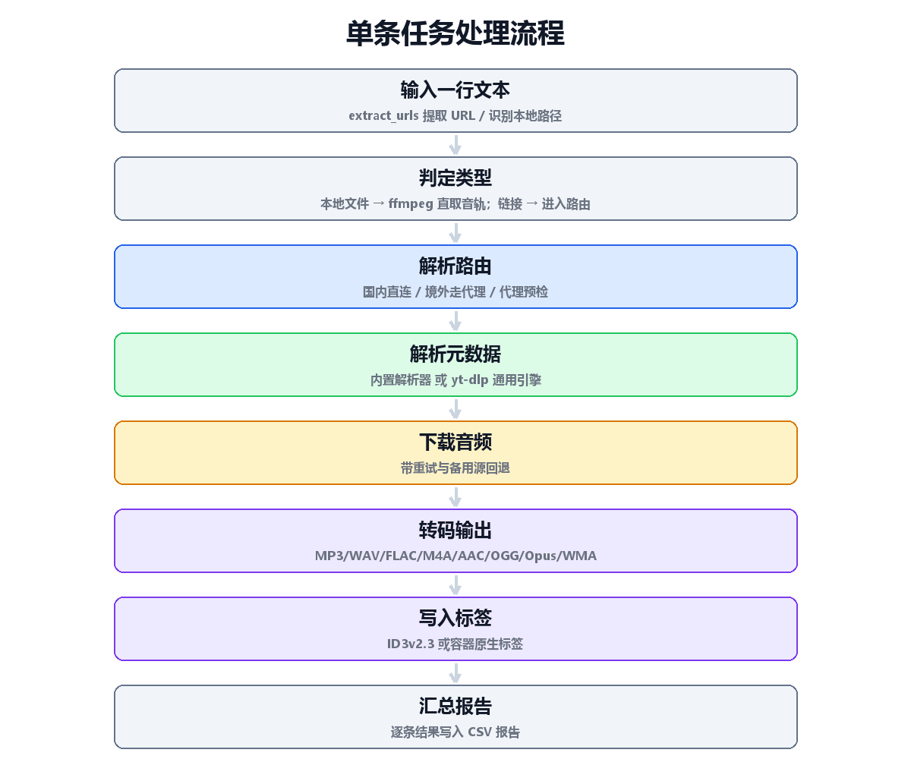
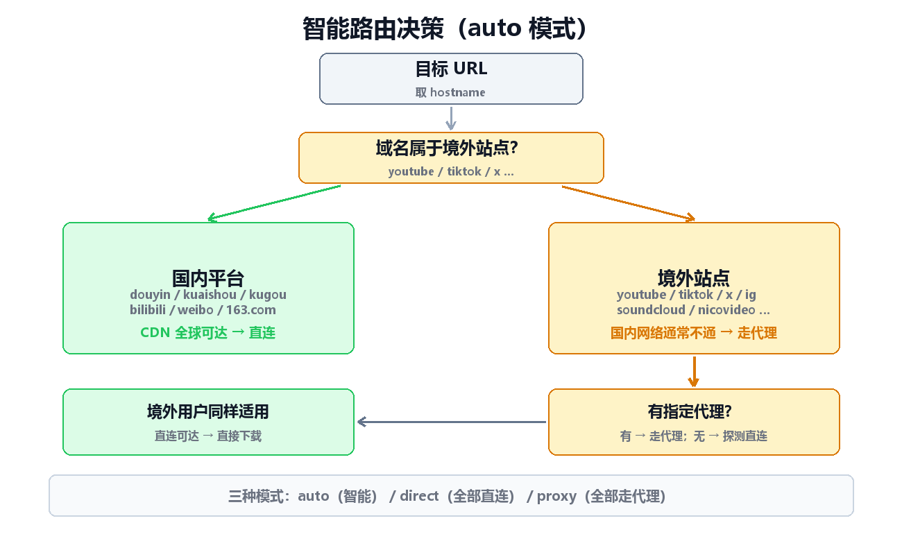
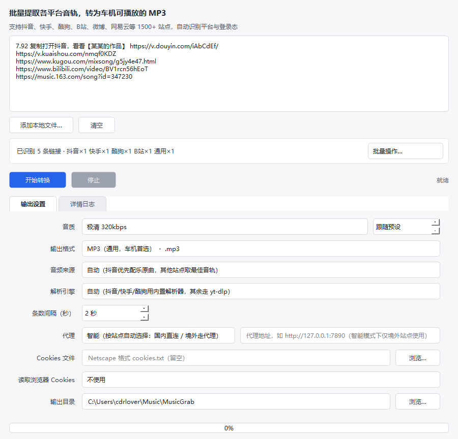
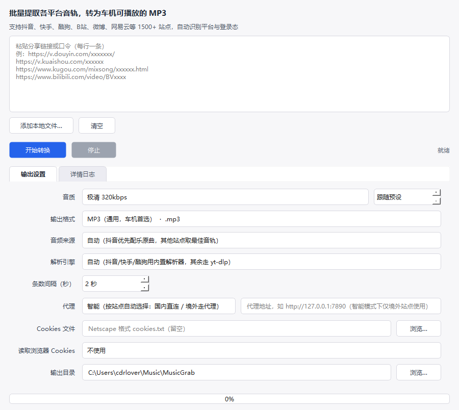
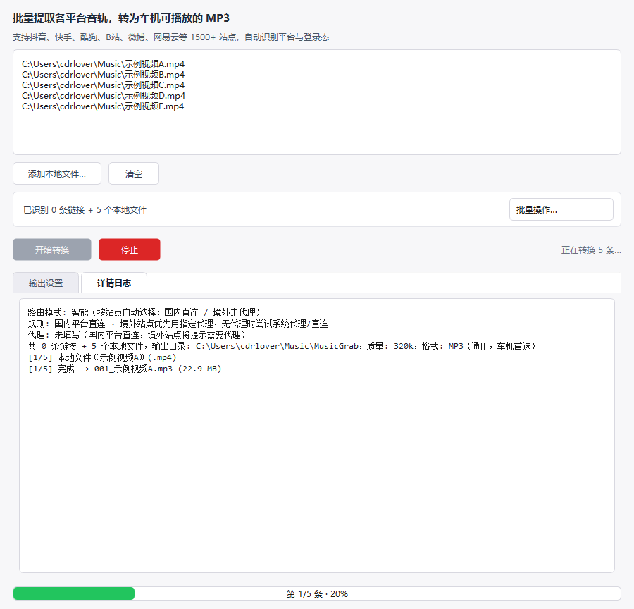

# 从 0 到 1：用 Python 写一款支持 1500+ 站点的音轨批量提取工具（含完整架构与踩坑复盘）

> **原创声明**：本文为原创技术文章，代码与文档均基于作者实际开发项目整理。
> **首发声明**：首发于 CSDN。
> **资源下载**：文末提供完整可用的 Windows 单文件程序（免安装、免 Python 环境）。

---

## 导读

> 做这个项目的起因很朴素：车机 U 盘里塞满了 MP3，但每次想加新歌都得先下载、再用别的工具转格式、再手动改文件名和标签。
> 于是我想：**把「粘贴链接 → 拿到能直接插车机播的 MP3」这件事，压到一次双击之内。**
>
> 这篇文章完整记录了从需求分析、架构设计、协议逆向，到打包分发、缺陷复盘的全过程。里面包含 **12 个真实踩过的坑**，其中 3 个是我自己写出来的 bug 被用户反馈后才发现的——我把它们的定位过程一并写了出来，因为**定位思路比结论更值钱**。

**你将读到：**

- 一套「双引擎 + 智能路由 + 多格式转码」的完整架构设计
- 抖音 / 酷狗的接口逆向思路（不涉及破解 DRM）
- 12 个真实坑位的定位与修复过程（含 3 个自造 bug）
- 一次完整的**开源合规风险评估**，包括为什么我最终没把程序放上应用商店
- 全部源码结构与 64 个单元测试的组织方式

---

## 目录

1. [需求分析：为什么不用现成工具](#1-需求分析为什么不用现成工具)
2. [整体架构设计](#2-整体架构设计)
3. [关键实现：双引擎解析](#3-关键实现双引擎解析)
4. [关键实现：智能路由](#4-关键实现智能路由)
5. [关键实现：多格式输出与本地文件](#5-关键实现多格式输出与本地文件)
6. [界面演进：从命令行到选项页](#6-界面演进从命令行到选项页)
7. [踩坑复盘：12 个真实坑位](#7-踩坑复盘12-个真实坑位)
8. [工程化：测试、打包与分发](#8-工程化测试打包与分发)
9. [一次认真的合规评估](#9-一次认真的合规评估)
10. [效果与数据](#10-效果与数据)
11. [资源下载与使用](#11-资源下载与使用)
12. [总结与后续规划](#12-总结与后续规划)

---

## 1. 需求分析：为什么不用现成工具

最开始我以为这事很简单，直到列出真实需求才发现处处是坑：

| 需求 | 真实痛点 |
|---|---|
| 批量 | 一次要处理几十条，不是逐条下载 |
| 平台多 | 抖音/快手/酷狗/B站/微博/网易云… 链接格式完全不同 |
| 免登录优先 | 绝大多数内容不需要登录就能拿到 |
| 免安装 | 发给家人/同事要能直接双击运行 |
| 车机兼容 | 采样率、声道、ID3 版本、车机认不认 |
| 出错能看懂 | 不能让用户对着 `ERROR: Unsupported URL` 干瞪眼 |

最后一个需求直接决定了这个项目的形态：**用户不看日志，但一定会看弹窗和状态行**。所以后面所有错误处理都围绕"让人知道下一步该干什么"来设计。

### 工具选型

现成方案不少，但都不理想：

- **yt-dlp**：覆盖面极广（1751 个 extractor），但它对国内平台的音频提取并不好，而且**不写 ID3 标签**、不支持批量和 GUI
- **各平台专用下载器**：一个平台一个，格式不一，无法统一输出
- **在线转换站**：要上传文件，隐私和速度都不可控

所以最终方案是**自研解析器 + yt-dlp 兜底**的双引擎架构。

---

## 2. 整体架构设计



分五层，每层职责单一、可独立替换：

```
接入层   链接粘贴（多行/口令/短链）  ·  本地文件（30+ 容器）
路由层   智能路由（国内直连 / 境外走代理）  ·  代理预检
解析层   内置解析器（抖音/快手/酷狗）      ·  通用引擎（yt-dlp 1500+）
处理层   下载（重试/备用源回退）            ·  转码（ffmpeg 8 格式）
输出层   ID3 标签（v2.3 / 原生标签）        ·  CSV 报告（可追溯）
```

### 目录结构

```
douyin-mp3/
├── douyin_mp3/
│   ├── __init__.py      # 名称/版本/APP_ID + 控制台窗口抑制
│   ├── cli.py           # 命令行入口（argparse）
│   ├── gui.py           # PySide6 图形界面
│   ├── app.py           # GUI 打包入口
│   ├── config.py        # 全局配置、输出格式定义、ConvertOptions
│   ├── parser.py        # 抖音解析 + 平台识别 + URL 提取
│   ├── kuaishou.py      # 快手解析器
│   ├── kugou.py         # 酷狗解析器
│   ├── generic.py       # yt-dlp 通用引擎封装
│   ├── proxy.py         # 智能路由引擎 + 代理检测
│   ├── downloader.py    # 带重试的下载器
│   ├── converter.py     # ffmpeg 转码 + 多格式标签写入
│   ├── cookies.py       # 浏览器/文件 cookies 读取
│   ├── batch.py         # 批处理主流程
│   └── winconsole.py    # Windows 子进程控制台窗口抑制
├── packaging/           # 打包脚本、图标生成、MSIX 清单
├── tests/               # 64 个单元测试
└── docs/                # 支持站点清单、隐私政策、上架清单
```



**关键设计取舍**：`batch.py` 里的 `BatchProcessor` 不知道任何具体平台细节，它只负责"给我一行文本，我还你一条结果"。平台差异全部收敛在各自模块里，新增一个平台只需要写一个 `fetch_info()`。

---

## 3. 关键实现：双引擎解析

### 3.1 抖音：两级数据源 + 自动回退

抖音的分享页把数据放在 `<script id="RENDER_DATA">` 里（URL 编码的 JSON），新版页面改用 `window._ROUTER_DATA`。两个都要支持：

```python
RENDER_DATA_RE = re.compile(
    r'<script[^>]+id="RENDER_DATA"[^>]*>(.*?)</script>', re.DOTALL | re.IGNORECASE
)
ROUTER_DATA_RE = re.compile(
    r"window\._ROUTER_DATA\s*=\s*(\{.*?\})\s*;?\s*</script>", re.DOTALL
)

def _find_item_list(node):
    """递归在任意嵌套结构中定位 item_list，兼容页面结构变化。"""
    if isinstance(node, dict):
        if node.get("item_list") and node["item_list"]:
            return node["item_list"]
        for value in node.values():
            found = _find_item_list(value)
            if found:
                return found
    elif isinstance(node, list):
        for item in node:
            found = _find_item_list(item)
            if found:
                return found
    return None
```

**递归查找**是关键——抖音改版时经常只是把数据挪了个位置，写死路径就得跟着改。写完这版之后，后续几次页面改版我都没动过代码。

分享页取不到数据时（风控），自动回退到网页版详情页：

```python
candidates = [share_url, f"https://www.douyin.com/video/{aweme_id}"]
for candidate in candidates:
    resp = self.session.get(candidate, headers=headers, timeout=self.timeout)
    item_list = _find_item_list(payload)
    if item_list:
        return _parse_item(item_list[0], aweme_id, share_url)
```

### 3.2 酷狗：从"抓不到"到"稳定可解析"

酷狗是三个内置平台里最难的一个，前后折腾了三个阶段。

**阶段一：页面里的 `<audio>` 是空的**

```html
<audio class="music" id="myAudio" src=""></audio>
```

`src` 为空——因为它由 JS 运行时填充。服务端抓 HTML 拿不到直链。**这条路直接放弃。**

**阶段二：web 版播放接口返回 30020**

```
GET https://wwwapi.kugou.com/yy/index.php?r=play/getdata&hash=...
→ {"err_code":30020,"status":0,...}
```

`30020` 是"人机验证"，说明这个接口需要设备指纹和签名。逆向它需要复现 `infSign.min.js` 的签名算法和 `registerDev` 的设备注册流程，复杂且随改版失效——**投入产出比不合适，放弃**。

**阶段三：换移动端接口（成功）**

```python
mr = m_session.get(
    f"https://m.kugou.com/app/i/getSongInfo.php?cmd=playInfo&hash={song_hash}",
    timeout=self.timeout,
)
mj = mr.json()
play_url = mj.get("url")   # https://sharefs.kugou.com/.../xxx.mp3
```

移动端接口不需要签名，只要带 iPhone UA 和 `Referer: https://m.kugou.com/` 就能拿到直链。

**还有一个坑**：新版分享页 `https://www.kugou.com/song/#g5jy4e47` 里，`#` 后面是 ecid（`encode_album_audio_id`），不是 hash。但**同一个 ecid 也是合法的 mixsong 页面 ID**：

```python
def _resolve_ecid_url(url: str) -> str:
    """把 /song/#<ecid> 归一化为 /mixsong/<ecid>.html。

    新版歌曲页的 <audio> 由 JS 填充，但同一 ecid 通过 mixsong 页面
    可访问，那里带有 data-hash / dataFromSmarty，可直接提取 hash。
    """
    m = KUGOU_SONG_ECID_RE.search(url)
    if m:
        return f"https://www.kugou.com/mixsong/{m.group(1)}.html"
    return url
```

而归一化后拿到 hash，再走移动端接口取直链——**一条链路打通了 `/mixsong/`、`/song/#ecid`、`hash=` 三种链接形态**。

顺带从页面的 `dataFromSmarty` 里提取准确的歌名/歌手/时长，比正则抓 `<title>` 靠谱得多：

```python
SMARTY_DATA_RE = re.compile(r"dataFromSmarty\s*=\s*(\[.*?\])\s*[,;]", re.DOTALL)
```

### 3.3 通用引擎：yt-dlp 的封装

`generic.py` 负责把 yt-dlp 变成一个"和内置解析器同构"的接口，并补上它不做的事——**写 ID3 标签**：

```python
opts: dict = {
    "format": "bestaudio/best",
    "outtmpl": str(dest_base) + ".%(ext)s",
    "socket_timeout": 30,
    "retries": 2,
    "ignoreerrors": False,
}
if proxy:
    opts["proxy"] = proxy
```

---

## 4. 关键实现：智能路由

### 4.1 问题的由来

最初的版本里，代理是"全有或全无"的：代理框填了就**所有**请求（包括国内平台）都走代理；留空就**所有**请求（包括境外站点）都直连。

这带来一个非常隐蔽的故障：用户的代理软件没启动，程序报的却是

```
解析失败(第1次): HTTPSConnectionPool(... ProxyError('Unable to connect to proxy' ...
（可能被风控或页面已改版，可稍后重试或提供 cookies）
```

**报错完全指错了方向**——用户会去折腾风控和 cookies，而真正的原因是代理没开。

### 4.2 判定依据：目标域名，不是用户所在地

核心洞察是：**中国平台的 CDN 是全球部署的**。抖音、快手、B站、酷狗、网易云在德国、美国都能直连访问。所以"国内平台 → 直连"这条规则，**对国内用户和境外用户同时成立**。



```python
OVERSEAS_DOMAINS = frozenset({
    "youtube.com", "youtu.be", "tiktok.com", "twitter.com", "x.com",
    "instagram.com", "facebook.com", "reddit.com", "niconico.jp",
    "soundcloud.com", "vimeo.com", "twitch.tv", "spotify.com", ...
})

DOMESTIC_DOMAINS = frozenset({
    "douyin.com", "iesdouyin.com", "kuaishou.com", "kugou.com",
    "bilibili.com", "b23.tv", "weibo.com", "music.163.com", "163.net",
    "y.qq.com", "ixigua.com", "xiaohongshu.com", ...
})
```

### 4.3 决策函数

```python
def resolve_route(url, mode="auto", proxy=None) -> Route:
    host = (urlparse(url).hostname or "").lower()

    if _host_matches(host, OVERSEAS_DOMAINS):
        if has_proxy:
            return Route(True, f"境外站点 {host}，使用代理 {text}")
        if host_reachable(host):          # 3 秒 TCP 探测
            return Route(False, f"境外站点 {host} 直连可达（当前网络无需代理）")
        if _system_proxy_exists():
            return Route(False, f"境外站点 {host} 直连不通，跟随系统代理", use_system=True)
        return Route(False, "", f"境外站点 {host} 在当前网络下不可达，请在「代理」中填写代理地址后重试")

    if _host_matches(host, DOMESTIC_DOMAINS):
        return Route(False, f"国内平台 {host}，直连")
    return Route(False, f"直连 {host or '未知域名'}")
```

关键在那个 `host_reachable()` 探测——**它让"境外用户"也能正常工作**：美国用户访问 YouTube 时探测成功，直接直连下载；中国用户探测失败，提示配置代理。

### 4.4 逐条决策

路由是**每条任务**独立决定的，不是全局设置：

```python
route = resolve_route(url, options.route_mode, options.proxy)
if route.error:
    return TaskResult(index, url, "failed", route.error)
self._log(f"[{index}/{total}] 路由: {route.reason}")
self._apply_route(client, route)     # 动态改写会话代理
```

运行日志长这样，一眼就能核对：

```
路由模式: 智能（按站点自动选择：国内直连 / 境外走代理）
规则: 国内平台直连 · 境外站点优先用指定代理，无代理时尝试系统代理/直连
[1/3] 路由: 国内平台 www.douyin.com，直连
[2/3] 路由: 国内平台 www.kugou.com，直连
[3/3] 路由: 境外站点 www.youtube.com，使用代理 http://127.0.0.1:7890
```

---

## 5. 关键实现：多格式输出与本地文件

### 5.1 八种输出格式

```python
OUTPUT_FORMATS = {
    "mp3":  OutputFormat("mp3",  "mp3",  "MP3（通用，车机首选）", "libmp3lame"),
    "wav":  OutputFormat("wav",  "wav",  "WAV（无损，体积大）",  "pcm_s16le", lossless=True),
    "flac": OutputFormat("flac", "flac", "FLAC（无损，体积小）", "flac",      lossless=True),
    "m4a":  OutputFormat("m4a",  "m4a",  "M4A / AAC",           "aac", container="ipod"),
    "aac":  OutputFormat("aac",  "aac",  "AAC（ADTS 裸流）",     "aac"),
    "ogg":  OutputFormat("ogg",  "ogg",  "OGG Vorbis",          "libvorbis"),
    "opus": OutputFormat("opus", "opus", "Opus（高压缩比）",     "libopus", sample_rate=48000),
    "wma":  OutputFormat("wma",  "wma",  "WMA（老车机兼容）",   "wmav2"),
}
```

标签写入策略：**MP3 继续用 mutagen 写 ID3v2.3**（车机兼容性最好，这是整个项目的核心诉求），其余格式交给 ffmpeg 的 `-metadata` 写容器原生标签：

| 格式 | 标签载体 | 验证方式 |
|---|---|---|
| MP3 | ID3v2.3 | mutagen 读取 `TIT2/TPE1/TALB/TRCK` |
| FLAC / OGG / Opus | Vorbis Comment | `mutagen.flac` / `mutagen.oggvorbis` |
| M4A | MP4 Atom | `mutagen.mp4` 读 `©nam/©ART/©alb` |
| WMA | ASF | `mutagen.asf` 读 `WM/AlbumTitle` |
| WAV | RIFF LIST-INFO | 二进制扫描 `INAM`/`IART` chunk |

> Opus 是个例外：编码器只接受 48kHz，所以格式定义里加了 `sample_rate=48000` 覆盖全局的 44.1kHz。

### 5.2 本地文件：绕开一切解析

本地视频完全不需要联网、不需要解析接口，`ffmpeg` 直接抽音轨：

```python
def collect_local_files(lines: list[str]) -> list[Path]:
    files: list[Path] = []
    for line in lines:
        text = line.strip().strip('"').strip("'")
        if not text or "://" in text:
            continue
        path = Path(text).expanduser()
        if not path.is_file():
            continue
        if path.suffix.lower() not in (VIDEO_EXTENSIONS | AUDIO_EXTENSIONS):
            continue
        if path not in files:
            files.append(path)
    return files
```

支持 30+ 常见容器：`mp4 / mkv / mov / avi / flv / f4v / wmv / webm / ts / m2ts / 3gp / rmvb / rm / mpg / mpeg / vob / asf / ogv / divx` 等。

---

## 6. 界面演进：从命令行到选项页

界面改了三版，每一版都是被真实使用场景逼出来的。

### 第一版：可折叠面板

最初"输出设置"是个可展开的折叠面板。问题是——**展开后 8 个控件挤在一起，间距过密，且部分控件显示不全**。用户反馈是"元素布局太紧凑，个别不能正常显示"。

### 第二版：选项页 + 统一控件高度

改成 `QTabWidget` 两个页签：**输出设置** / **详情日志**，按钮上移，链接框固定 150px。

同时解决了一类"看起来差不多但就是对不齐"的问题——所有控件统一到 **32px**：

```css
QLineEdit, QComboBox, QPushButton { min-height: 30px; }
QSpinBox { min-height: 26px; }                    /* 微调按钮占位更小 */
QLineEdit, QComboBox { padding: 0px 9px; }
QSpinBox { padding: 0px 0px 0px 9px; }           /* 右侧留给微调按钮 */
QSpinBox::up-button { height: 13px; }
QSpinBox::down-button { height: 13px; }
```

### 第三版：多行粘贴的下拉工具条

粘贴 2 条以上时自动出现一条工具栏：



```
┌────────────────────────────────────────────────────────────────┐
│ 已识别 5 条链接 · 抖音×1 快手×1 酷狗×1 B站×1 通用×1   [批量操作… ▾] │
└────────────────────────────────────────────────────────────────┘
```

「批量操作…」提供 5 个动作：**提取纯链接**（剥掉口令文字只留 URL）、**去重**（按 URL 去重，不是按整行文本——这是个 bug，见坑位 8）、**按平台排序**、**载入示例**、**清空**。

主界面：



处理过程（详情日志页实时刷新）：



---

## 7. 踩坑复盘：12 个真实坑位

这一节是全文最有价值的部分。**12 个坑里有 3 个是我自己写出来的 bug**，而且都是用户先发现、我后定位的。

### 坑位 1：QSpinBox 的上下箭头"消失"了 🔴

**现象**：数字输入框右侧的上下微调按钮不见了。

**原因**：我给所有输入控件套了统一样式 `padding: 4px 6px`。这个 padding 会**同时挤压内部按钮**，按钮被压扁到看不见。

**修法**：给 `QSpinBox` 单独一套 padding（右侧留 0），并把按钮高度显式设为 13px。

```css
QSpinBox { padding: 0px 0px 0px 9px; }
QSpinBox::up-button { height: 13px; }
```

> **教训**：给 Qt 控件做统一样式时，不能假设一个 `padding` 规则对所有控件都安全。内部有子控件（SpinBox 的按钮、ComboBox 的下拉箭头）的控件需要特殊处理。

### 坑位 2：预设音质完全失效，实际输出全是 32kbps 🔴

**现象**：音质下拉框选了"高清 192kbps"，但产出的文件只有 32kbps。

**原因**——这是我认为最隐蔽的一个 bug：

```python
self.custom_quality = QSpinBox()
self.custom_quality.setRange(32, 320)
self.custom_quality.setSpecialValueText("预设")
self.custom_quality.setValue(0)      # ← 想表达"跟随预设"
```

`QSpinBox` 范围是 32~320，`setValue(0)` 会被**钳制到 32**。而读取逻辑是：

```python
if self.custom_quality.value() >= 32:    # ← 恒为真！
    quality = str(self.custom_quality.value())   # 永远是 "32"
else:
    quality = self.quality_box.currentData()      # 死代码
```

于是预设下拉框是个摆设，**用户拿到的永远是最低码率**。

**修法**：把范围改成 `0~320`，用 `0` 作为"跟随预设"的哨兵值：

```python
self.custom_quality.setRange(0, 320)
self.custom_quality.setSpecialValueText("跟随预设")
...
custom = self.custom_quality.value()
quality = str(custom) if custom > 0 else (self.quality_box.currentData() or "192")
```

并做双向联动：选预设时清空自定义框，填自定义时下拉切到"自定义"项。

### 坑位 3：代理不通，却报"可能被风控" 🔴

**现象**（用户原文）：

```
[1/1] 解析失败(第1次): ... ProxyError('Unable to connect to proxy' ...
（可能被风控或页面已改版，可稍后重试或提供 cookies）
[1/1] 解析失败(第2次): ...
[1/1] 解析失败(第3次): ...
```

**原因**：`requests` 抛的 `ProxyError` 落进了通用的 `except RequestException` 分支，于是被当成"解析失败"重试 3 次（每次还 sleep 2/4/6 秒），最后套上了风控的文案。

**修法**：新增 `proxy.py` 模块，三件事——启动前预检代理连通性、识别 `ProxyError`（含 `__cause__`/`__context__` 链）、把它翻译成人话：

```python
def proxy_error_message(exc, proxy=None) -> str:
    detail = str(exc)
    if "Connection refused" in detail or "10061" in detail:
        return (f"代理无法连接（{normalize_proxy(proxy)}）——"
                f"请确认代理软件已启动、端口与设置一致；"
                f"若不需要代理请清空「代理」设置并勾选「直连」")
    ...
```

并让代理错误**立即失败**（连不上是确定性失败，重试无意义）：

```python
except (DouyinParseError, requests.RequestException) as exc:
    if is_proxy_error(exc):
        msg = proxy_error_message(exc, options.proxy)
        return TaskResult(index, url, "failed", msg)   # 不重试
```

### 坑位 4：`requests` 会静默继承系统代理

**现象**：用户什么都没配代理，却报代理错误。

**原因**：`requests.Session()` 默认 `trust_env=True`，会自动读取 **Windows 注册表**的 `ProxyEnable/ProxyServer` 和 `HTTP_PROXY` 环境变量。很多代理软件（Clash/v2rayN）会开"系统代理"开关，程序退出后设置还留着。

**修法**：默认 `trust_env=False` 强制直连，并把"是否跟随系统代理"变成一个显式的路由模式。

### 坑位 5：内置解析器绕过了路由决策 🔴

**现象**：智能模式下配了代理，酷狗/快手仍然走代理（国内平台本该直连）。

**原因**：审查代码时发现 `_kugou_client()` 写死了 `proxy=self.options.proxy`，而且**没有调用 `_apply_route()`**。抖音那条分支调了，所以只有抖音是对的。

**修法**：客户端创建时不再固定代理，改为逐条动态设置；并加了两个回归测试锁住行为：

```python
def test_builtin_clients_do_not_hardcode_proxy():
    options = ConvertOptions(proxy="http://127.0.0.1:7890", route_mode="auto")
    processor = BatchProcessor(options)
    assert processor._kuaishou_client().session.proxies == {}
    assert processor._kugou_client().session.proxies == {}
```

### 坑位 6：处理中点不开"详情日志"

**现象**：点了"开始转换"之后，页签点不动，必须等全部处理完才能切到日志页。

**原因**：`self.tabs.setEnabled(False)` —— `QTabWidget.setEnabled(False)` **连页签栏一起禁用**。

**修法**：只锁设置页的**内容**，页签栏保持可点击：

```python
self.settings_page.setEnabled(False)   # 设置项不可改，页签仍可切
```

### 坑位 7：打包版运行时闪黑色终端窗口

**现象**：运行 exe 时黑色控制台窗口一闪而过。

**原因**：`--windowed` 打包的 GUI 程序**自身没有控制台**，但它调用的 `ffmpeg`/`ffprobe` 是控制台程序——父进程无控制台时，Windows 只能为子进程**新建一个控制台窗口**，转码结束即消失。yt-dlp 内部调 ffprobe 时同样会闪（我查了 yt-dlp 源码，它自己完全没用 `CREATE_NO_WINDOW`）。

**修法**：导入时全局包装 `subprocess.Popen`，仅当父进程自身无控制台时注入 `CREATE_NO_WINDOW`：

```python
def apply() -> bool:
    if parent_has_console():      # 命令行模式：不动，子进程照常继承
        return False
    original_init = subprocess.Popen.__init__
    def patched_init(self, *args, **kwargs):
        if not kwargs.get("creationflags"):
            kwargs["creationflags"] = create_no_window
        original_init(self, *args, **kwargs)
    subprocess.Popen.__init__ = patched_init
    return True
```

**验证方式**（我特意做了负对照，确保测试不是空转的）：写了个窗口枚举脚本，在转换过程中实时扫描 `ConsoleWindowClass`：

| 构建 | 检测结果 |
|---|---|
| 临时禁用补丁 | ⚠️ 检测到 `PseudoConsoleWindow` × 1 → FAIL |
| 恢复补丁 | ✅ **0 次**控制台窗口 → PASS，产物一致 |

### 坑位 8：去重逻辑按整行文本比较

**现象**：批量去重后，重复链接还在。

**原因**：我用整行文本判重，而 `"口令 https://v.douyin.com/aaa/"` 和 `"https://v.douyin.com/aaa/"` 是**不同字符串**。

**修法**：改为按提取出的 URL 判重，无 URL 的行（本地文件）才按文本判重。

### 坑位 9：QLabel 是 QFrame 的子类

**现象**：工具栏里的统计文字莫名其妙带了个边框。

**原因**：Qt 里 `QLabel` 继承自 `QFrame`！所以样式表里 `QFrame { border: 1px solid ... }` **会命中 QLabel**。

**修法**：用对象名限定作用域，`#bulkToolbar { ... }` 只命中那一个控件。

> 这个坑很隐蔽——CSS 选择器在这点上的行为和 Web 不一样。

### 坑位 10：Qt 样式表会级联到子控件

**现象**：给父容器设了背景色，内部的 QLabel / QComboBox 也跟着变了。

**原因**：Qt 样式表设置在父控件上时，会**应用到所有子控件**（除非用 `>` 限定直接子级）。

**修法**：用 `QScrollArea > QWidget > QWidget` 这类后代选择器精确控制。

### 坑位 11：`PrintWindow` 截图对 QScrollArea 有渲染伪影

**现象**：用 Win32 `PrintWindow` 抓 GUI 窗口，内容区整块空白。

**原因**：`QScrollArea` 的 viewport 是独立合成层，`PrintWindow` 抓不全。

**修法**：改用 Qt 自己的 `widget.grab()` 渲染，完全绕开 OS 合成。后面所有界面截图都用这个方式产出。

### 坑位 12：Opus 编码器只吃 48kHz

**现象**：Opus 格式转换全部失败，报 `Invalid argument`。

**原因**：Opus 规范只允许 8/12/16/24/48kHz，而我全局强制 44.1kHz。

**修法**：格式定义里加 `sample_rate` 字段覆盖。

### 坑位 13（彩蛋）：抖音风控是间歇性的

同一条链接，第一次失败第二次成功——这不是 bug，是平台风控。程序内置 3 次重试（带退避）能覆盖绝大多数情况。**这一点值得单独写出来**，因为初版文档把它写成了"解析失败"，误导了不少用户。

---

## 8. 工程化：测试、打包与分发

### 8.1 测试

64 个单元测试，覆盖 URL 提取、平台识别、路由决策、代理判定、格式解析、标签写入：

```bash
$ pytest tests -q
64 passed in 0.92s
```

关键在于**测试跟着 bug 走**——每个修复过的坑都留了回归测试：

```python
def test_gui_source_does_not_disable_whole_tab_widget():
    """回归：源码中不得出现 `self.tabs.setEnabled(False)`（会禁用页签点击）。"""
    src = inspect.getsource(gui_mod)
    assert "self.tabs.setEnabled(False)" not in src
    assert "self.settings_page.setEnabled(False)" in src
```

### 8.2 打包

单文件 exe，用户不需要装 Python：

```powershell
python -m PyInstaller --noconfirm --clean `
  --onefile --windowed `
  --name MusicGrab `
  --icon assets\icon.ico `
  --add-data "assets\icon.png;assets" `
  --version-file packaging\version_info.txt `
  --collect-binaries imageio_ffmpeg `
  --collect-all yt_dlp `
  --hidden-import douyin_mp3.gui `
  --hidden-import mutagen.id3 `
  douyin_mp3\app.py
```

产物 **102MB**（含 yt-dlp 全量 + 内置 ffmpeg + PySide6），单文件、双击即用。

图标是**用代码画出来的**（`packaging/make_icons.py`），4 倍超采样矢量绘制后降采样，保证 16px 小尺寸也清晰：

```python
# 蓝色渐变圆角方形底板 + 白色「声波条 ⇅ 下载箭头」标记
draw.rounded_rectangle((m, m, size - m, size - m), radius=size // 4, fill=BLUE_TOP)
draw.rounded_rectangle((sx0, u(SHAFT_TOP), sx1, u(SHAFT_BOTTOM)), radius=..., fill=WHITE)
```

一次生成 `.ico`（16~256 共 7 档）、1024px PNG 母版、以及 MSIX 商店所需的全部尺寸。

### 8.3 界面自检工具

界面改动容易"改完看不出好坏"，所以我写了个脚本用 Qt 渲染当前界面并输出多尺寸对比图：

```bash
python packaging/probe_layout.py 0 --paste   # 0=输出设置页，--paste=填充示例链接
```


---

## 9. 一次认真的合规评估

这个项目功能做完后，我认真评估了"能不能上架应用商店赚钱"，结论是**不建议**。这里把过程和结论都写出来，因为它比代码更值得讨论。

### 9.1 三个层面的风险

**① 应用商店层面**

Microsoft Store Policies 11.2 明确写着：知识产权人可以通过在线表单**发起侵权投诉**。配合"repeat infringers 可终止账号"，意味着上架后被一封投诉下架 + 账号牵连是真实风险。

**② 平台用户协议层面**

抖音《用户服务协议》5.1 / 5.3(4)：

> 不得使用任何**插件、外挂、系统或第三方工具**对抖音的正常运行进行干扰……包括使用任何**自动化程序、软件或类似工具接入抖音，收集或处理其中信息、内容**；
> 禁止以……**爬虫抓取、模拟下载**……等任何不正当方式……**下载**、使用抖音中的信息或内容。

酷狗（5sing）5.1.7(6)(9) 同类条款。**我自研的酷狗解析器，字面上就落在禁止条款里。**

**③ 中国法律层面**

- 《著作权法》10(五) 复制权：下载转码即构成复制
- 第 49 条：禁止"故意避开或者破坏技术措施"
- **法释〔2025〕5 号第十三条**（2025-04-26 施行）：明知他人实施侵犯著作权犯罪，而**为他人避开、破坏技术措施提供技术服务**，违法所得达标即**以侵犯著作权罪追究刑事责任**
- 同解释**第二十八条**："通过收取服务费、会员费或者广告费等方式营利的，收取的费用应当认定为'违法所得'"

最后一条尤其关键：**收费金额直接计入刑事门槛的基数**。据最高检 2026-10-22 通报，2023 年至 2026 年 9 月全国起诉侵犯著作权犯罪 7100 余人，其中张某案开发运营视听聚合软件、传播 8.3 万余部作品、收取广告费 3.92 亿元。

### 9.2 一个技术性的硬门槛：GPLv3

我查了打包进去的 ffmpeg 二进制：

```
ffmpeg version 7.1-essentials_build-www.gyan.dev
configuration: --enable-gpl --enable-version3 ...
```

**GPLv3 传染**——闭源商用分发它，就必须同时开源整个应用。（yt-dlp 是 Unlicense，无此问题。）

### 9.3 我的结论

> 保留「yt-dlp + 自研解析器 + 商业化收费」的形态，不建议提交应用商店。
> 真正可行的路径是**砍掉平台解析，转型为纯本地车机音频工具**——
> 只处理用户自己已有的文件，不复制他人作品、不违反平台协议、不触发技术措施问题。
> 商业上已有验证：App Store 上同类工具「MP3 Converter – Audio Extractor」有 4.8 万条评分。

有意思的是，本项目**已经完成了路线 A 的 80%**——本地文件输入、8 种输出格式、车机兼容的 ID3v2.3、批量重命名与标签整理，正是纯本地车机工具的核心能力。

---

## 10. 效果与数据

### 平台支持矩阵（实测）

| 平台 | 引擎 | 实测结果 |
|---|---|---|
| 抖音 | 内置 | ✅ 分享短链 / 网页长链 / `?modal_id=` / 完整口令文本 全部通过 |
| 快手 | 内置 | ✅ 短链通过（部分作品需 App 环境） |
| 酷狗 | 内置 | ✅ 免费曲通过；⚠️ VIP 曲需登录 |
| B站 / 微博 | yt-dlp | ✅ 含短链、番剧、音频区 |
| 网易云音乐 | yt-dlp | ✅ 部分歌曲有地域限制 |
| YouTube / TikTok / X / IG | yt-dlp | ⚠️ 需代理；YouTube 需 PO Token |

### 本地视频容器实测

用 ffmpeg 生成 11 种真实容器的视频（含可听音轨），走完整批处理：

| 容器 | 结果 | 容器 | 结果 |
|---|---|---|---|
| MP4 / MKV / MOV | ✅ | FLV / WMV | ✅ |
| AVI / WebM | ✅ | MPEG-TS / M4V | ✅ |
| 3GP / RMVB | ✅ | MP3 / Opus 音频 | ✅ |

**11/11 全部成功**，产物时长与标签均校验通过。（VOB 例外：内置 ffmpeg 缺 `mpegps` 解复用器。）

### 输出格式实测

8 种格式全部转码成功，标签载体逐个校验：

| 格式 | 产物 | 标签验证 |
|---|---|---|
| MP3 | 320k / 44.1kHz | ID3v2.3 `TIT2/TPE1/TALB/TRCK` ✅ |
| WAV | 无损 PCM | RIFF LIST-INFO `INAM/IART` ✅ |
| FLAC | 无损压缩 | Vorbis Comment ✅ |
| M4A | AAC 128k | MP4 Atom `©nam/©ART/©alb` ✅ |
| AAC / OGG / Opus | — | ADTS / Vorbis / Opus Comment ✅ |
| WMA | wmv2 | ASF `WM/AlbumTitle` ✅ |

---

## 11. 资源下载与使用

### 下载

**CSDN 资源下载**：见本文关联资源 `MusicGrab-v1.6.0-win-x64.zip`

- 单文件 `MusicGrab.exe`，**免安装、免 Python 环境**
- 内置 ffmpeg 与 yt-dlp，离线可转码
- 附 `使用说明.txt` / `README.md` / `LICENSE`

> SHA256（发布包）：`ba9b2b4bd091eda5f38a15b157e818ae0318aac13b6737e3c438410f1a6a5b48`
> SHA256（exe）：`c196c2571063d0147e4ab30c068e45698735051504de354f1b9fec25dccca612`

### 快速上手

1. 解压，双击 `MusicGrab.exe`
2. 粘贴链接（每行一条），或点「添加本地文件…」选视频
3. 点「开始转换」

### 命令行用法

```powershell
# 批量转换
MusicGrab convert "https://v.douyin.com/xxx/" "https://www.kugou.com/mixsong/xxx.html" -q 320 -o "D:\Music"

# 本地视频转 FLAC
MusicGrab convert "D:\视频\MV.mp4" -f flac

# 境外站点走代理
MusicGrab convert "https://youtu.be/xxxx" --proxy http://127.0.0.1:7890
```

---

## 12. 总结与后续规划

### 做完之后的几点体会

**1. 错误信息的价值 >= 功能的完备度**

一个能跑但报错看不懂的工具，用户体验是负的。把 `ProxyError` 翻译成"代理软件没启动，端口 10090 连不上"，比多支持 10 个站点更能提升留存。

**2. 架构的价值在于隔离变化**

这个项目里抖音改版过好几次、酷狗接口换了一轮、yt-dlp 换了 PO Token 机制，但**没有一个波及到 `batch.py`**。平台差异全部收敛在各自模块——这是当初坚持分层换来的。

**3. 工具类项目的天花板往往不在技术**

做完功能我才意识到：真正的约束来自**版权和平台协议**，而不是代码。把合规评估放在开发之前，能省下大量沉没成本。

### 后续计划

- [ ] 平台解析拆成**可选插件**，主程序聚焦纯本地车机音频管理（目录规范、批量重命名、ID3 整理）
- [ ] 更换 **LGPL** 版 ffmpeg，解除 GPLv3 传染
- [ ] 增补"保留原采样率"选项，避免 48kHz 素材被强制重采样
- [ ] 单元测试覆盖度提升到 80%+

---

## 结语

这个项目从"想把歌装进车机"开始，演变成了一个对**异常处理、跨平台一致性、资源生命周期**都有要求的完整桌面应用。过程中最有价值的不是任何一行代码，而是那些**被用户一句话点出来的 bug**——它们逼着我从"能跑就行"转向"让人知道下一步该干什么"。

如果你也在做类似的工具化应用，希望这篇踩坑记录能帮你省点时间。

**欢迎在评论区交流：**
- 你在处理平台风控时用过哪些有效手段？
- 你的工具里有没有遇到过"提示信息把人带偏"的坑？
- 有没有想让我支持但目前还不行的站点？

---

### 相关阅读

- 项目文档：[README.md](https://github.com/your-name/douyin-mp3)
- 支持站点完整清单与实测明细：[docs/SUPPORTED_SITES.md](https://github.com/your-name/douyin-mp3/blob/main/docs/SUPPORTED_SITES.md)
- 隐私政策：[docs/PRIVACY_POLICY.md](https://github.com/your-name/douyin-mp3/blob/main/docs/PRIVACY_POLICY.md)

### 许可

MIT License. © 2026 cdrlover

> **免责声明**：本工具仅供个人学习、研究与非商业用途使用。请使用者自行遵守所访问平台的服务条款及所在地法律法规，因使用本工具产生的任何法律责任由使用者自行承担。程序仅处理用户主动粘贴的公开链接与用户本地文件，不内置破解或绕过 DRM、付费内容的功能。
